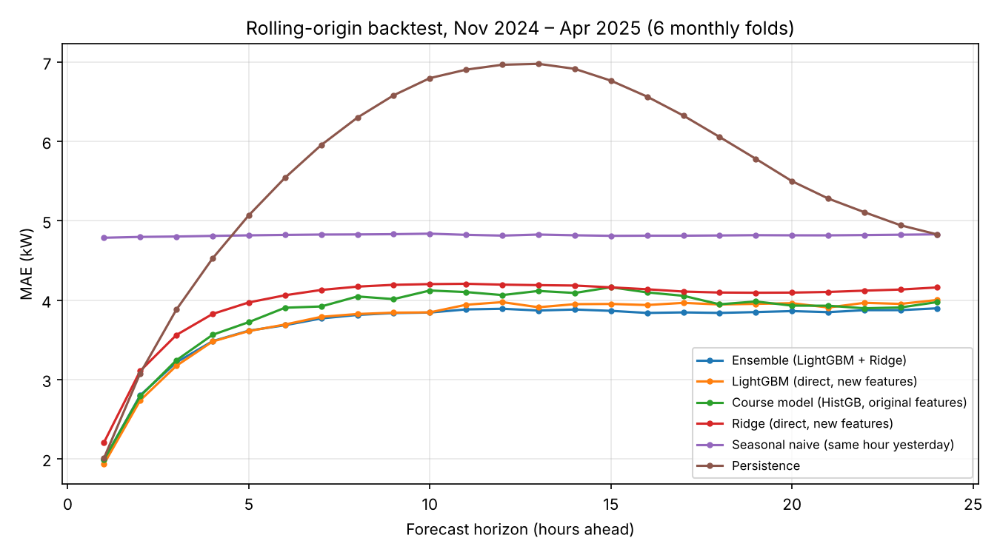

# Day-ahead electrical load forecasting for an industrial plant

Forecasts the electrical load (kW) of the main low-voltage distribution board of the
[ETA Research Factory](https://www.ptw.tu-darmstadt.de/eta-fabrik/) at TU Darmstadt for each of
the next 24 hours, given only the last 24 hours of load and weather data.

This started as a five-person group project in the *Machine Learning Applications* course
(TU Darmstadt, winter 2025/26). This repository is my own rebuild and extension of it:
a cleaner pipeline, a stricter evaluation, and new models and features.

## Results

Evaluated with a **rolling-origin backtest**: six folds, each testing one month
(Nov 2024 – Apr 2025, about 4,300 forecast origins) and training only on data that ends 24 h
before that month starts. Metric: mean absolute error over all 24 horizons.

| Model | MAE (kW) | vs. persistence |
|---|---:|---:|
| **Ensemble (LightGBM + Ridge)** | **3.67** | **−34.5 %** |
| LightGBM, one model per horizon, new features | 3.72 | −33.7 % |
| Original course model (HistGB, original features), re-run here | 3.82 | −32.0 % |
| Ridge, one model per horizon, new features | 3.98 | −29.2 % |
| Seasonal naive (same hour yesterday) | 4.82 | −14.1 % |
| Persistence (next 24 h = now) | 5.61 | — |



Per-fold and per-horizon numbers are in [`results/`](results/).

**What the chart shows.** Persistence is good one hour ahead but worst at around 12 h, when
day and night are reversed. "Same hour yesterday" is flat at about 4.8 kW because it is
wrong whenever today is not like yesterday (Monday after a weekend, holidays). The learned
models combine both kinds of information and stay under 4 kW at every horizon.

## What changed compared with the course version

- **Gap-safe time index.** The raw data has 51 missing hours. The original code shifted
  rows, so after each gap a "24 h lag" pointed to the wrong hour. Here the series is
  reindexed to a complete hourly grid first.
- **Rolling-origin validation** with a 24 h gap instead of a single 70/15/15 split, so the
  score is averaged over six different months and no training target overlaps the test month.
- **Two naive baselines.** Without "same hour yesterday" it is not clear how much the models
  actually learn beyond copying yesterday.
- **Features for the target hour.** Each horizon gets the hour and weekday of the time being
  forecast, whether that day is a weekend or holiday, and the load at the same hour
  yesterday. Hesse holidays are computed in code (including the Easter-based ones), so no
  external file is needed.
- **Direct multi-horizon LightGBM** with an L1 (MAE) objective, plus a simple average with Ridge.
- **A leakage test** (`tests/test_no_leakage.py`) checks that changing any data after time t
  does not change the features at t.

## Honest limitations

- The gain over the original course model is small (3.82 → 3.67 kW, about 4 %). Most of the
  improvement over the naive baselines was already in the course version.
- LightGBM settings were chosen sensibly but **not tuned**.
- The course's physics-aware PyTorch MLP (penalties for negative load, exceeding capacity
  and unrealistic ramps) is not included here yet.
- No weather *forecasts* are used, only observed weather from the last 24 h.
- Only about one year of data, so yearly seasonality is barely learnable.

## Next steps

Tune LightGBM with time-series cross-validation, add the physics-aware MLP, use quantile
objectives for prediction intervals, and look at the error on Mondays and holidays separately.

## Run it

```bash
pip install -r requirements.txt
# put the course data in data/train.csv (not included, see data/README.md)
python scripts/run_experiments.py   # ~4–5 min on a laptop
python -m pytest tests
```

## Structure

```
src/loadforecast/
  config.py     constants (window, horizons, column names)
  data.py       loading, hourly reindexing, Hesse holiday calendar
  features.py   origin features, target-hour features, original course features
  models.py     baselines, course model, Ridge, LightGBM, ensemble
  evaluate.py   rolling-origin backtest
scripts/run_experiments.py   runs everything, writes results/
tests/test_no_leakage.py
```
